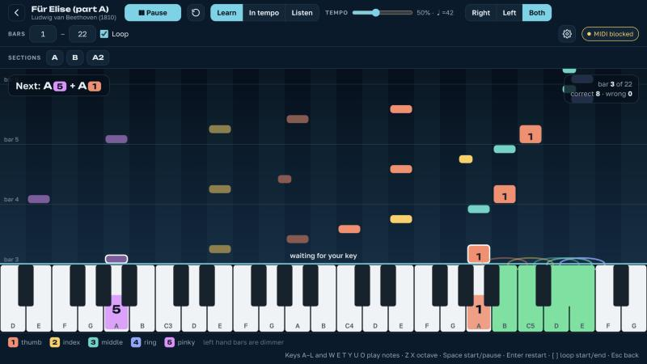

# koimidi — free piano trainer

**koimidi** is a free, open-source piano trainer for MIDI keyboards that runs in the browser.
Falling notes with finger numbers, a "wait for the right key" mode, and built-in sound for keyboards that have none.
Learn the built-in pieces, your own MIDI and MusicXML files, or any piece from a Synthesia-style piano tutorial video.
No sign-up, no server: your files are parsed on your device and never leave it.

**Try it:** https://meruslan.github.io/koimidi/ · [По-русски](README.ru.md)

<p align="center"></p>

## Why

Learning a melody without reading sheet music means you want three things at once: bars that fall onto the keys, the finger to use on each bar, and a trainer that *waits* for you instead of running ahead. Add a keyboard with no sound of its own (a small controller like the Komplete Kontrol M32) and you also need the browser to play what you press. None of the free web tools we tried did all of that, so this one does.

## Features

- **Falling bars, colour = finger.** The number sits on the leading edge, and the target key lights up with the same finger.
- **Learn mode waits for you.** Time stops on each note (or chord) until you play it. Play ahead of the bar and it counts at once; the bars catch up smoothly, no jump.
- **In-tempo mode** keeps going and counts late and wrong notes. **Listen mode** plays the piece for you.
- **Your own sound.** A small WebAudio piano plays whatever you press, with sustain pedal support (CC 64), so a silent controller is enough.
- **A real grand piano.** Pick *Grand piano · Salamander* in Settings: a sampled Yamaha C5 (about 10 MB, downloaded once, then works offline) played by [SpessaSynth](https://github.com/spessasus/spessasynth_lib).
- **Your own SoundFonts.** Add any `.sf2` or `.sf3` pack and choose its instrument; packs stay in your browser.
- **Open MIDI and MusicXML** (`.mid`, `.midi`, `.musicxml`, `.xml`, compressed `.mxl`). Parsing happens in the browser; files are kept in your browser's storage (IndexedDB) for next time.
- **Pieces from videos.** Paste a YouTube link to a piano tutorial, pick a video in another browser tab, or open a video file. By default koimidi listens: it writes down the notes it hears, with the tempo and the bars (a draft: some notes may be wrong, and the hands are split by pitch). For a Synthesia-style video (falling notes that light up the keys) switch to *by the lit keys*: koimidi finds the keyboard in the picture, notes down every key that lights up and tells the hands apart by colour, which is exact where it works. Either way the piece lands in *Your files* with fingering, like any MIDI file. Check the bars on a small piano roll, change the time signature or move the bar lines by a beat, listen, then practise.
- **Automatic fingering** (right and left hand) for files that carry none, using a Parncutt-style ergonomic cost model and dynamic programming. Fingering from MusicXML `<fingering>` is kept.
- **Your own fingering.** Click a bar and pick a finger (or press `1`–`5`). The choice is kept in this browser for that piece, the automatic fingering rearranges the notes around it, and a small dot marks the fingers you chose.
- **Export MusicXML with fingering**, yours included, to print the piece or open it in MuseScore and other notation programs.
- **Count-in and metronome.** *In tempo* starts after one bar of clicks; the metronome clicks every beat in *In tempo* and *Listen*.
- **Keyboard profile.** Tell koimidi how many keys your controller has, or let it guess from the device name (Komplete Kontrol M32 → 32 keys). Controllers up to 49 keys appear on screen key for key, at the octave that suits the piece; pieces that need more keys are flagged in the library and while you practise.
- **Record your playing** with the ● button, listen back, and save it as a `.mid` file.
- **Loop any range of bars** on the strip of bars above the stage: click a bar, drag across several, or click a section's name when the score has rehearsal marks. A thin stripe under each bar shows how many mistakes you made there.
- **Your hands on screen.** A picture of both hands, every fingertip in its finger's colour, lights up the fingers of the next notes, with their names beside it.
- **Any octave accepted** on small keyboards, with a hint about which way to press OCTAVE.
- **Tempo from 20 % to 100 %**, right / left / both hands, note names as *do re mi* or *C D E*.
- **The trainer plays the other hand.** Practise the right hand while koimidi plays the left (or the other way round) from grey bars; in *Learn* mode the other hand waits with you, so the chord sounds when you play your note.
- **Progress.** Practice time, accuracy of every pass, a strip of mistakes per bar (click a bar to loop it), your hardest bars, and how the current bar range has gone pass by pass. The library shows time and best result for each piece.
- **Works offline.** After the first visit the whole app is kept in the browser; install it from the address bar or the **Install** button and it opens like an app, without the internet.
- **No MIDI keyboard?** Computer keys `A`–`L` (white) and `W E T Y U O` (black) work, and while no keyboard is connected the on-screen keys show which letter plays them; tapping the on-screen keys works too.
- **Built-in library** of 16 public-domain pieces, from *Twinkle, Twinkle* to *Für Elise* (part A), the Minuet in G, Brahms' Lullaby and *Korobeiniki*, typeset for koimidi.
- **Three looks:** *Paper*, a printed score on warm paper with the keys behind a red felt strip; *Lacquer*, the same at night; *Console*, an aluminium panel with a dark screen. By default it follows the system's light or dark mode; choose in Settings.
- English and Russian interface; settings and your files stay in the browser.

## Requirements

Web MIDI works in Chromium browsers: **Chrome, Edge, Brave, Opera** on desktop and Android.
Safari and Firefox cannot see MIDI keyboards; everything else still works there with the computer keys.
The site must be served over `https://` or opened from `localhost` / a local file for Web MIDI to be available.

## Using it

1. Open the site, plug in the keyboard, allow MIDI access when the browser asks.
2. Pick a piece from the library or open your own `.mid` / `.musicxml` / `.mxl`.
3. Press the highlighted key to start. In *Learn* mode nothing moves until you play the right note.
4. Narrow the loop to a few bars (drag across the strip of bars above the stage, click a section's name, type them in the **Bars** fields, or `[` / `]` while playing), slow the tempo with − and +, repeat, widen. In a two-hand piece, practise one hand with **The trainer plays the other hand** on, then both.
5. A finger feels wrong? Click its bar and choose another one; the rest of the fingering adapts.
6. Switch to *In tempo* when it feels easy, with the metronome if it helps. Record a take with ● to hear yourself.
7. Open **Progress** (the chart button) to see which bars still go wrong, and loop them.

### A piece from a video

1. Press **From a video** on the home screen and paste a YouTube link. Easy versions work best: search for "<song> easy piano tutorial".
2. Press **Recognise** and let the browser share this tab: that is how koimidi sees the keyboard in the player. The video plays from the start; the strip under it shows the keys koimidi sees lit. Fast piece? Choose half speed first; it is more accurate.
3. When the video ends (or you press **Done**), check the result: title, time signature, bar lines, octave if the video shows only part of the keyboard. **Listen**, then **Open in the trainer**.

A video that does not play outside YouTube, or one on another site: open it in another tab and choose **Video in another tab**. A file on your computer: **Video file**, or drop it on the page.

What works: Synthesia-style renderers of most kinds (keys lit whole or in part, letters on the keys and on the bars, a drawn keyboard above a filmed one, fades and title cards, slow tutorials). What does not: a filmed piano whose keys do not light up (koimidi says so and offers to listen instead), and glow-only visualisers where the keys stay dark.

Shortcuts: `Space` start/pause · `Enter` restart · `[` `]` loop start/end at the current bar · `Z` `X` shift the computer-keyboard octave · `1`–`5` finger for the selected bar · `Esc` back to the library.

## Privacy

There is no account, no analytics and no network requests after the page loads, apart from the browser checking for a new version of the app, the grand piano sound and the listening model (about 1 MB, for recognising a video by ear), which are downloaded from this same site the first time you use them, and YouTube's own player when you open a YouTube link (it plays as on YouTube, under YouTube's terms). While recognising a video koimidi looks at the shared tab frame by frame in memory; no frame and no sound is stored or sent anywhere, and sharing stops when the recognition does. Imported files, SoundFont packs, the fingers you chose, your progress and your settings are stored only in your browser (localStorage, IndexedDB and Cache Storage); clearing site data removes them. Recordings stay in memory until you save them. Nothing is uploaded anywhere.

## Development

```bash
npm install
npm run dev        # http://localhost:5173
npm test           # vitest: parsers, MusicXML export, fingering, practice engine, progress, recorder, library, video recognition
npm run build      # type-check + production build into dist/
node scripts/bench-video.mjs video.mp4 --piece ode-to-joy   # the video recognition against a library piece (needs ffmpeg)
node scripts/bench-video.mjs --audio video.mp4 --piece ode-to-joy   # the same for the fallback by ear
```

Plain TypeScript + Vite, no UI framework. Layout of `src/`:

| Folder | What lives there |
| --- | --- |
| `score/` | the score model, MIDI and MusicXML importers, MusicXML export, the compact library notation, automatic fingering and the player's finger edits |
| `practice/` | the practice engine (modes, waiting, hit windows, loop range, octave tolerance, count-in, metronome, the trainer's hand, pass statistics), progress and the recorder |
| `render/` | the canvas renderer (falling bars, keyboard), in the colours of the current look |
| `audio/` | the WebAudio synth and metronome, sampled instruments through SpessaSynth, sound banks (the grand piano and the player's packs) |
| `input/` | Web MIDI and computer-keyboard input, keyboard profiles |
| `storage/` | settings in localStorage; files, finger edits and progress in IndexedDB |
| `video/` | pieces from videos: finding the keyboard in a frame, following the keys, beats, bars and hands, the YouTube player, tab and file capture, listening by ear with Basic Pitch, and synthetic videos for the tests |
| `library/` | built-in pieces |
| `ui/` | home, practice and "from a video" screens, the strip of bars, the hands picture, the progress sheet |
| `theme.ts`, `styles.css`, `fonts.css` | the three looks as colour tokens, the stylesheet, and the bundled fonts (Piazzolla, JetBrains Mono, Golos Text, Unbounded) |
| `sw.js`, `pwa.ts` | the service worker (its file list is filled in by the build, see `vite.config.ts`) and its registration, update prompt and Install button |

Deployment is a GitHub Actions workflow (`.github/workflows/deploy.yml`) that runs the tests, builds, and publishes `dist/` to GitHub Pages on every push to `main`. The build uses a relative base path, so it works from any folder or domain.

### The grand piano

`public/sounds/salamander-grand-piano.sf3` is built from the Salamander Grand Piano SF2 published by [FreePats](https://freepats.zenvoid.org/Piano/acoustic-grand-piano.html): 4 of its 16 velocity layers, a milder velocity curve, shortened tails, Ogg Vorbis samples. To rebuild it (needs `ffmpeg` with libvorbis):

```bash
node scripts/build-piano.mjs SalamanderGrandPiano-V3+20200602.sf2
```

### Adding a library piece

Pieces live in `src/library/pieces.ts` in a small text notation:

```
title: Ode to Joy
composer: Ludwig van Beethoven (1824)
time: 4/4
tempo: 112
R: @A E4:3 E4 F4:4 G4:5 | G4 F4 E4 D4 | C4:1 C4 D4 E4 | E4. D4/8 D4/2 |
L: C3/1:1 | G2/1:5 | C3/1 | G2/2 C3/2 |
```

`C4` is middle C; `/8` is an eighth, `.` a dot, `~` a tie, `:3` a finger, `[C4 E4 G4]/2:135` a chord, `r/4` a rest, `|` a barline (checked against the time signature, so typos surface as test failures), `@A` a section mark. Only pieces in the public domain, typeset by you, please; see `tests/library.test.ts`.

## Roadmap

Every release starts with a session on a real controller (Komplete Kontrol M32, Chrome over https); what breaks there comes first.

- **v0.2 — learn your own piece** (done). Edit a finger by clicking its bar; edits are kept in the browser per file and the automatic fingering works around them. Export MusicXML with `<fingering>`. Count-in and metronome for the in-tempo mode. Keyboard profile: your controller's range on screen and a warning when a piece does not fit it. Record your playing and export it as `.mid`.
- **v0.3 — two hands for real** (done). Practise one hand while the trainer plays the other. Progress statistics per piece and per bar range. Offline use as a PWA.
- **v0.4 — sound** (done). Sampled piano (Salamander Grand Piano as SF3 through SpessaSynth) and your own SoundFont packs (SF2/SF3). More public-domain pieces in the library.
- **v0.5 — pieces from videos** (done). Recognise a Synthesia-style video (YouTube link, another tab, or a file) into a piece with hands, tempo and bars; listen by ear when there is no lit keyboard.
- **Deferred:** vector-PDF import in the browser, MIDI output to an external synth, scanned-sheet recognition (OMR).

## Credits and licenses

- Code: [MIT](LICENSE).
- Library pieces: public-domain works typeset for this project.
- Grand piano sound: [Salamander Grand Piano V3](https://freepats.zenvoid.org/Piano/acoustic-grand-piano.html) by Alexander Holm, [CC BY 3.0](https://creativecommons.org/licenses/by/3.0/); SF2 assembly by FreePats; reduced for koimidi as described in `public/sounds/salamander-grand-piano.txt`. This file is under CC BY 3.0, not MIT.
- [SpessaSynth](https://github.com/spessasus/spessasynth_lib) (Apache-2.0), [@tonejs/midi](https://github.com/Tonejs/Midi) (MIT), [fflate](https://github.com/101arrowz/fflate) (MIT), fonts [Golos Text](https://github.com/fontsource/fontsource) and [Unbounded](https://github.com/fontsource/fontsource) via Fontsource (SIL OFL).
- Recognition by ear: [Basic Pitch](https://github.com/spotify/basic-pitch-ts) by Spotify (Apache-2.0), running on [TensorFlow.js](https://github.com/tensorflow/tfjs) (Apache-2.0); loaded only when used.
- Beat tracking after Ellis, *Beat tracking by dynamic programming* (2007).
- Fingering cost model after Parncutt, Sloboda, Clarke, Raekallio & Desain, *An ergonomic model of keyboard fingering for melodic fragments* (1997).

The name: Bashkir *көй* ("melody") + koi carp in a pond + MIDI.
